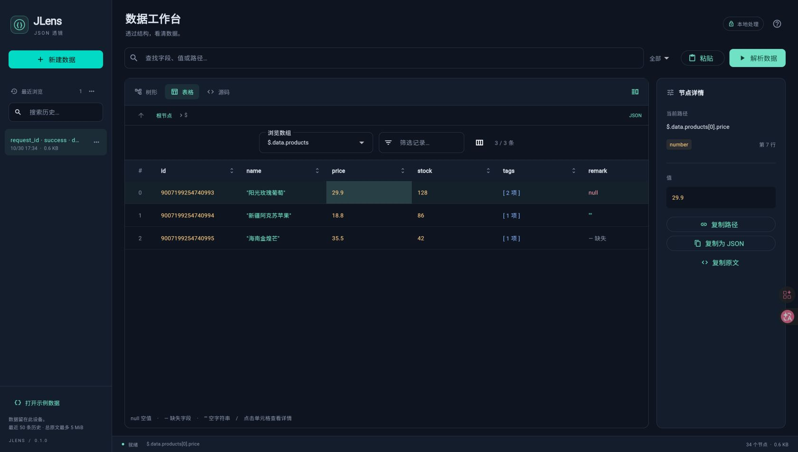

# JLens · JSON 透镜

透过结构，看清数据。使用 Flutter / Dart 开发的本地 JSON 与 Python dict 浏览工具。



## 运行

需要 [Flutter stable](https://docs.flutter.dev/install)（Dart 3.11 或更高版本）。

```sh
flutter pub get
flutter run -d chrome
```

桌面端可用 `flutter run -d macos`、`flutter run -d windows` 或 `flutter run -d linux`；移动端先启动模拟器或连接设备，再用 `flutter run`。各原生平台需要对应的 Flutter 构建工具链。

```sh
flutter analyze
flutter test
flutter build web
```

Web 构建产物在 `build/web`。可用任意静态文件服务器托管，例如：

```sh
python3 -m http.server 8080 --directory build/web
```

浏览器访问 `http://localhost:8080`。剪贴板读取需要 localhost 或 HTTPS 环境，亦可在源码区直接粘贴。

## 使用

1. 点击「粘贴」，或新建数据后在源码区输入；点击「解析数据」，也可按 `⌘ + Enter` / `Ctrl + Enter`。
2. 在树形、表格与源码间切换。树形可点击箭头或双击节点行内容展开、折叠，也可用上下键选中、左右键展开折叠或进入子节点、返回父节点；表格可选数组、筛选记录、点击列标题排序、选择显示列。
3. 按 `⌘F` / `Ctrl+F` 聚焦搜索，可按字段、值、路径或类型查找；连续输入会合并检索，结果中的命中内容高亮。点击结果定位节点，再切换视图继续查看。类型名称为 `object`、`array`、`string`、`number`、`boolean`、`null`。
4. 节点详情可复制路径、原文与标准 JSON。右键节点（触屏长按）可复制路径、值或 JSON，容器还可选择「聚焦此节点」；聚焦后，可用上方导航回到父级或根节点。窄屏通过右上角的节点详情按钮打开详情。
5. 源码工具菜单提供格式化和压缩。格式化会把输入转换为标准 JSON；格式化前成功解析的原文仍在历史中。

「复制值」对字符串复制解码后的文本，对数字保留精确数值文本，对容器复制紧凑 JSON；「复制 JSON」则保留字符串引号并格式化容器。

历史在成功解析后自动保存，按原文去重；可搜索、命名、删除、清空。恢复时还原原文、视图、焦点、展开节点和选中路径。编辑中的未解析输入不会保存；切换记录或新建数据前会提示确认。

## 数据语义

- 优先识别严格 JSON，再识别 Python 数据字面量，不执行输入。
- Python 子集支持字符串键 `dict`、`list`、单双引号字符串、常见转义、十进制整数和小数、指数、`True` / `False` / `None`、末尾逗号。
- 不支持 Python 表达式、函数调用、tuple、set、bytes、非字符串字典键、字符串前缀、三引号、注释、数字下划线、十六进制数与非有限数值。
- 数字按词法文本保存，展示、复制和数值排序均不依赖浮点转换；大整数和高精度小数不会被舍入。
- 表格中 `null`、`— 缺失`、`""` 分别表示空值、字段缺失和空字符串。
- 重复对象键会报错，避免同名值被覆盖。语法错误提供行列，并定位到源码。
- 树形节点与表格行使用惰性列表。输入上限为 2 MiB、50,000 个节点、128 层嵌套；超限会给出明确错误。

## 本地存储

用户输入在设备内解析，不上传到服务端。历史使用 [`shared_preferences`](https://pub.dev/packages/shared_preferences)，保留最近 50 条，总原文最多 5 MiB；超限淘汰最早访问记录。浏览器的配额仍可能先达到上限，写入失败会显示通知。读取失败时保留原存储，不用空历史覆盖。

历史属于浏览缓存，不是可靠备份。清除浏览器站点数据或卸载应用可能使其丢失；重要数据请复制另存。Web 渲染资源随构建产物提供，首次显示中文时可能需要下载字体。

## 代码结构

- `lib/core/document.dart`：无损数字节点、JSON / Python 字面量解析、源码范围、搜索与数值比较。
- `lib/core/workbench.dart`：视图状态、节点联动、历史管理及顺序持久化。
- `lib/ui/`：源码编辑器、树形、表格、主题。
- `lib/main.dart`：应用入口、响应式工作台、搜索、历史侧栏与详情。
- `assets/jlens.svg`：应用图标源文件；各平台图标由此导出。
- `test/`：解析语义、历史恢复及界面交互测试。

结构统计、JSONPath 查询语言和双文档差异对比留待后续版本。

## 验证范围

项目使用 Flutter 3.47.9 / Dart 3.13.7。静态检查、自动化测试及 Web、macOS Release 构建覆盖本次交互优化；此前浏览器实测覆盖表格数字精度、节点联动和刷新后的历史恢复。

工程包含 Web、Android、iOS、macOS、Windows、Linux 入口。macOS 已完成本机 Release 构建及交互验证，其余原生平台尚未完成打包与真机验证，运行前需安装相应工具链；Android 模板使用 Gradle 9.3.1，需要兼容的 JDK（17–25）。

### 交互性能验证

单个节点展开折叠仅更新该分支的可见行；换文档、改变聚焦范围、批量操作时重建可见行。源码原文未变时复用高亮分词结果。搜索连续输入合并检索，查询、文档和搜索模式未变时复用结果。

节点选择、展开和聚焦仅通知浏览区域，历史写入成功不触发额外界面刷新；写入期间的连续变更合并到下一份快照。树形结构、表格筛选排序结果及文档大小按数据变化更新；详情预览只生成显示范围内的内容，复制仍保留完整数据。

`test/interaction_performance_test.dart` 检查连续 10 次节点选择及保存：优化前工作台整体重建 20 次，优化后为 0 次，节点详情继续正常更新。此指标是界面重建次数，不代表帧率；浏览器无法使用 WebGL 时，仍可能受到 CPU 绘制的限制。

`test/large_document_performance_test.dart` 用 35,002 个节点、362,791 字节的合成文档，预热 5 次后采样 30 次。在同一本机 Flutter 测试环境中：

| 操作 | 优化前中位耗时 | 优化后中位耗时 |
| --- | --- | --- |
| 全部展开后，切换含两个叶节点的分支并完成测试帧 | 36.5 ms | 27.1 ms |
| 原文未变，仅改变选区后生成高亮文本片段 | 38.1 ms | 0.002 ms |

这是 debug 测试环境下的操作耗时，不代表 Release 帧率；高亮计时不含文本布局，修改原文后仍需重新分词。可运行 `flutter test test/large_document_performance_test.dart --reporter expanded` 复测，结果会随机器负载变化。

### macOS Release 构建

需先从 [Mac App Store 安装 Xcode](https://apps.apple.com/app/xcode/id497799835)，首次打开并完成初始化及许可确认。仅安装 Command Line Tools 不足以构建本应用。完整环境要求见 [Flutter macOS 配置说明](https://docs.flutter.dev/platform-integration/macos/setup)。

Xcode 安装在默认位置时，可在项目目录运行：

```sh
flutter pub get
DEVELOPER_DIR=/Applications/Xcode.app/Contents/Developer flutter build macos --release
```

成功后应用位于 `build/macos/Build/Products/Release/JLens.app`。该应用支持 Apple Silicon 与 Intel，可在本机运行；尚未进行分发公证。
